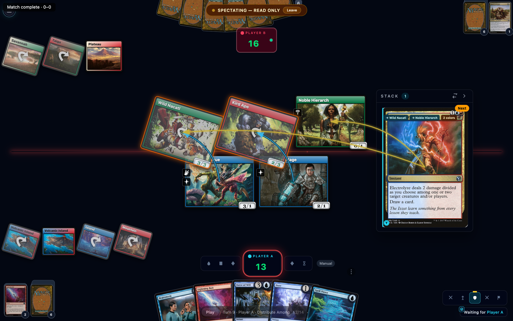
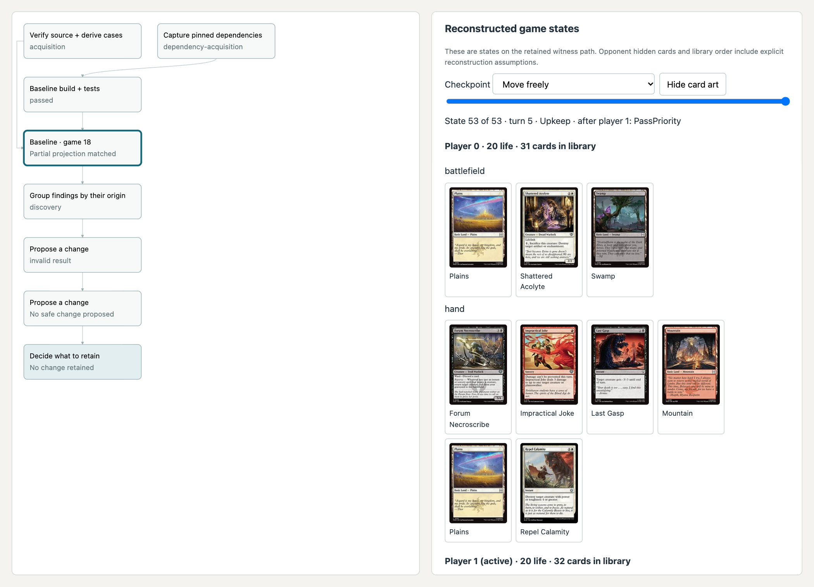

# coworld-mtg

A Magic: The Gathering engine that AI agents can play against each other, with
in-browser replays you can watch, and a loop that improves the engine by
checking it against real recorded games.

It is built on [Phase](https://github.com/phase-rs/phase), the best open source
Rust rules engine we found, and packaged as a
[Coworld](https://github.com/metta-AI/coworld) so agents can play in local
episodes, in the browser, and in hosted leagues.



*The replay viewer mid-combat. Player B attacks with Wild Nacatl and Kird Ape,
Player A blocks with Vendilion Clique and Snapcaster Mage, then casts
Electrolyze at Wild Nacatl and Noble Hierarch. This is a staged position played
through the engine. The pill at the bottom expands into event and turn
timelines. Card images via [Scryfall](https://scryfall.com); card art and text
© Wizards of the Coast.*

## Why this exists

Phase enforces the rules properly: mana, casting, priority, the stack, combat,
triggers, replacement effects, layers and state-based actions. Three things
were missing for our purposes:

- **Watchable replays.** Every accepted action, its events and the resulting
  state are recorded, and the browser client plays them back with event, turn
  and game timelines.
- **Mechanics coverage.** Not every mechanic was supported, so not every card
  could be played.
- **Rules correctness.** A few interactions were implemented wrongly.

Magic's rules are huge and full of strange interactions, so reading the engine
is a poor way to find out whether it is right. The more useful move was to turn
"is the engine right?" into a problem an AI can hill-climb.

## Improving the engine from recorded games

[17Lands](https://www.17lands.com/public_datasets) publishes records of real
games played on the official MTG Arena client. They are incomplete: they do not
show every action a player took (passing priority, for example) and they hide
some state. So the question we ask of each recorded game is:

> Can the engine find a legal, supported sequence of plays that matches what
> the recording says happened?

Card definitions come from [Scryfall](https://scryfall.com). The harness
searches the engine's own legal actions for a trajectory that agrees with each
observation in turn. Alongside that, it checks core invariants on every state
it visits: a card cannot be in two zones at once, a zone cannot reference a
card that does not exist, and neither a player nor a spectator can see a hidden
hand.

~~~mermaid
flowchart LR
  G[Recorded 17Lands game] --> S[Search for a legal engine trajectory<br/>that matches the recording]
  S -->|matches| W[Witness: the engine can reproduce this game]
  S -->|unsupported card, failed fit,<br/>broken invariant| Q[Issue with its source evidence]
  Q --> F[LLM inspects and proposes a fix]
  F --> R[Rebuild, rerun, review]
  R -->|updated engine| G
~~~



*One real MTG Arena game from 17Lands, reconstructed in the engine: the pipeline
on the left found a legal sequence of 53 engine actions that agrees with the
recording, and the right side steps through the resulting board. Card images
via [Scryfall](https://scryfall.com); card art and text © Wizards of the Coast.*

Each shortcoming (a card whose mechanics are unsupported, a game the engine
cannot reproduce, an invariant that breaks) comes with the game that exposed
it. An LLM is usually able to inspect that evidence and propose a fix, and the
fixed engine goes back through the same checks. Feed in more recordings and the
loop keeps producing updates. Some are useful but banal, like supporting
another mechanic. Others are subtle engine logic faults that affect many games.

A failed search is a lead and not a verdict. The fault may be in the engine,
the card definitions, the data mapping or the search itself, and running out of
search budget does not establish a rules bug.

### Fixes upstreamed to Phase

Coworld builds pin `phase-rs/phase` directly. These fixes, found here, have been
merged into it:

- [Route reflexive triggers through the stack](https://github.com/phase-rs/phase/pull/7332)
- [Persist colors spent to cast through trigger collection](https://github.com/phase-rs/phase/pull/7039)
- [Keep prepared-copy spells stack-resident through targeting](https://github.com/phase-rs/phase/pull/7017)
- [Serialize game-state hash collections deterministically](https://github.com/phase-rs/phase/pull/7008)
- [Verify offered casts with the auto-payment authority](https://github.com/phase-rs/phase/pull/7007)
- [Round-trip prepared state through serialization](https://github.com/phase-rs/phase/pull/6997)
- [Make mana payments atomic](https://github.com/phase-rs/phase/pull/5793)
- [Validate complete flashback costs](https://github.com/phase-rs/phase/pull/5780)
- [Stabilize blocker prompt ordering](https://github.com/phase-rs/phase/pull/5771)

### Where the loop stands

| Part | Current state |
| --- | --- |
| Seeded engine exploration and deterministic replay | Implemented: exact legal actions, events, state hashes, checkpoints and invariant checks. |
| 17Lands ingestion | Implemented: official CSV normalization and card-ID mapping with source provenance. |
| Recorded-game trajectory fitting | Implemented: legal-action search with backtracking and typed observation/state traces. The frozen 20-game cohort covers two turns from each player; full-game coverage is in progress. |
| Card support preflight | Checks names and setup. Complete card-effect, token and face identity checks are planned. |
| Regression cases and repair evaluation | Implemented: typed case execution, checking, reduction and reviewed acceptance, orchestrated by agents. |
| Whole improvement epoch as one program | Implemented in [CAOS](docs/caos-factory.md): acquisition, discovery, model proposals and reviews, candidate builds, comparison and a linked decision. |
| The same epoch on one machine | Implemented in [`loop/`](loop/README.md): one command measures the cohort, briefs a model contributor, re-measures its change, gates and reviews it. No scheduler needed. |

Some limits worth knowing before reading the results:

- On the [frozen 20-game cohort](fixtures/17lands/sos-cohort-20/README.md),
  eight games match the supported projection, nine need mulligan reconstruction
  that is not yet supported, and the rest hit a deadline or boundary. Even the
  matches have no fully covered milestones yet. These games have been inspected
  before and are not unseen holdouts.
- Combat-damage, mana-spent and ability observations are left unchecked where
  their meaning in the source data is not established. The raw data contains
  negative combat-damage values, for instance.
- Run locally, the loop has [accepted five model-proposed changes in a row](loop/runs/2026-11-24/README.md).
  At three turns per player, the eleven games without mulligans went from
  seven matches to all eleven. At four turns, three match. Those runs used
  public card data, not the private corpus.
- In the [first full CAOS run](replays/caos-factory-20260920/README.md), the
  run pictured above, the model contributor looked at the evidence and chose to
  propose no change.

To go deeper: [the active plan](docs/17lands-discovery-plan.md),
[how to run and inspect the pipeline](docs/17lands-factory.md),
[recorded runs](replays/README.md), and the
[verifiable case loop](docs/verifiable-cases.md).

## Play and watch locally

Playing needs the [private card corpus](#private-runtime-corpus). From the repo
root:

```sh
npm install
npm run build
scripts/fetch-corpus.sh
scripts/cargo.sh build -p coworld-mtg-server -p goldfish
mkdir -p tmp/local-play
cat > tmp/local-play/config.json <<'JSON'
{
  "tokens": ["tokA", "tokB"],
  "players": [{"name": "browser-0"}, {"name": "browser-1"}],
  "seed": 4242,
  "decks": ["lorehold_excavation", "fractal_convergence"],
  "games_to_win": 1,
  "clock_s": 360,
  "decision_cap_s": 30,
  "player_connect_timeout_s": 60
}
JSON
COGAME_HOST=127.0.0.1 \
COGAME_PORT=8080 \
COGAME_CORPUS_DIR="$PWD/.private/corpus" \
COGAME_CONFIG_URI=tmp/local-play/config.json \
COGAME_RESULTS_URI=tmp/local-play/results.json \
COGAME_SAVE_REPLAY_URI=tmp/local-play/replay.json \
COGAME_LOG_URI=tmp/local-play/log.txt \
COGAME_WEB_DIST="$PWD/web/dist" \
scripts/cargo.sh run -p coworld-mtg-server
```

Open these URLs in separate browser profiles (for example, a normal and an
incognito window) to control both seats:

- `http://127.0.0.1:8080/client/player?slot=0&token=tokA`
- `http://127.0.0.1:8080/client/player?slot=1&token=tokB`

To play against the baseline instead, leave the second browser closed and run:

```sh
scripts/cargo.sh run -p goldfish -- --url 'ws://127.0.0.1:8080/player?slot=1&token=tokB'
```

`http://127.0.0.1:8080/client/global` is a spectator view with no hidden
information. The finished game is saved to `tmp/local-play/replay.json`; start
the server with `COGAME_LOAD_REPLAY_URI` pointing at that file and open
`/client/replay` to watch it. Space plays and pauses, Left/Right step through
events, Shift+Left/Right through turns, and Page Up/Page Down through games.
H hides the controls down to a small pill so they stay out of the way.
The [protocol](docs/protocol.md) describes the wire and replay formats.

The supplied decks are real 40-card `SOS.PremierDraft` lists captured from MTG
Arena play data by 17Lands. Published play consists of two single-game variants
with deck assignments reversed, so each challenger pilots Lorehold Excavation
and Fractal Convergence once. Published variants omit `seed`, which generates a
fresh root seed when the episode config is loaded. Supply `seed` explicitly, as
above, to reproduce the exact initial library orders and all later random
outcomes.

## How the repository is laid out

| Path | What it holds |
| --- | --- |
| `crates/phase-bridge` | Pins Phase, loads card data and decks, produces per-viewer projections and accepts exact legal actions. See [the Phase port contract](docs/phase-rules-port.md). |
| `crates/coworld-mtg-server` | Coworld authentication, clocks, scoring, results, replay persistence and viewer fan-out. Contains no Magic rules. |
| `crates/players/goldfish` | Baseline player that ranks the legal actions Phase offers. |
| `crates/coworld-mtg-harness` | Seeded exploration, deterministic replay, invariants and recorded-game fitting. |
| `phase-client/` | Thin Coworld transport, replay adapter and chrome over Phase's React client. New player, spectator and replay work belongs here. See the [client spec](docs/specs/0001-phase-client-for-coworld.md). |
| `web/` | The improvement-loop viewer (`web/src/factory/`) and a legacy renderer kept only so version-2 replays stay readable. |
| `caos-factory/` | The improvement epoch as a CAOS program. |
| `loop/` | The same epoch as one local command, with its gate and policy. |
| `replays/`, `cases/`, `fixtures/` | Recorded improvement runs, regression cases and frozen 17Lands cohorts. |

[PLAN.md](PLAN.md) has the roadmap and the invariants the game server must
keep. The [harness operations guide](docs/agent-improvement-harness-operations.md)
covers corpus, worker, replay, minimization and aggregation commands, and
[the software factory](docs/software-factory.md) describes the shared recording
protocol behind the improvement-loop viewer. The active workspace and preserved
builds are on [EC2](docs/ec2-workspace.md).

## Development checks

Rust commands should run through `scripts/cargo.sh`; it selects the toolchain
in `rust-toolchain.toml` even when another `cargo` or `rustc` appears earlier on
`PATH`. Run the complete local/CI gate with:

```sh
scripts/check.sh
```

Generated Rust and frontend output can consume many gigabytes. Preview guarded
cleanup with `scripts/clean-generated.sh --all`; add `--execute` only after
reviewing the resolved paths and sizes it prints.

## Private runtime corpus

The generated Phase card database and 17Lands-derived deck lists are not
distributed in this public repository. Authorized Softmax builds fetch the
content-addressed private corpus pinned by `corpus.lock.json`:

```sh
scripts/fetch-corpus.sh
```

This materializes `.private/corpus`, verifies the archive and every contained
file by SHA-256, and leaves all corpus content gitignored. Docker builds require
that materialized directory. Public source builds remain available without it;
run tests requiring real card data with
`scripts/cargo.sh test --workspace --features private-corpus-tests`.
